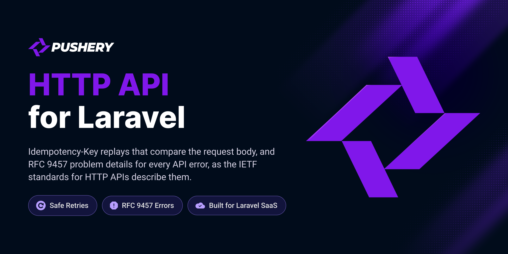

<p align="center">
  <a href="https://github.com/pushery/http-api-for-laravel">
    
  </a>
</p>

# HTTP API for Laravel

[](https://packagist.org/packages/pushery/http-api-for-laravel)
[](https://packagist.org/packages/pushery/http-api-for-laravel)
[](https://packagist.org/packages/pushery/http-api-for-laravel)
[](LICENSE)

[](https://pestphp.com)


[](https://phpstan.org)
[](https://laravel.com/docs/pint)

The IETF HTTP API standards for Laravel: Idempotency-Key replays that compare the request body, and RFC 9457 problem details for every API error.

## Documentation

**Full documentation at
[docs.pushery.com/http-api-for-laravel](https://docs.pushery.com/http-api-for-laravel/).**
This README is the quick start; the guides and the configuration reference live there.

## Requirements

- PHP 8.4+
- Laravel 13+

Tested on PostgreSQL and MySQL 8.4, the databases Laravel Cloud runs (serverless Postgres
and MySQL 8.4 LTS), so it runs there out of the box. The fast suite runs on SQLite.

Tested on **PHP 8.4** — the floor of the declared range, because a `>=` promise is
only proven by running on the boundary — and on **PHP 8.5**, so the upper half of
`^8.4` is exercised here rather than first by a consumer.

## Installation

```bash
composer require pushery/http-api-for-laravel
```

The service provider is registered automatically through package discovery.

## Configuration

Publish the configuration file:

```bash
php artisan vendor:publish --tag=http-api-config
```

This writes `config/http-api.php`, where every option is documented inline.

Every setting and the environment variables that change it without publishing the file are listed in
the [configuration reference](https://docs.pushery.com/http-api-for-laravel/#configuration).

## Usage

### An Idempotency-Key on a write

```php
use Illuminate\Http\Request;
use Illuminate\Support\Facades\Route;
use Pushery\HttpApi\Idempotency\Idempotent;

Route::post('/api/orders', function (Request $request) {
    return response()->json(['ordered' => $request->input('item')], 201);
})->middleware(['auth:sanctum', Idempotent::class]);
```

The first request under a key acts. A repeat gets the first answer back with
`Idempotent-Replayed: true`, the same key with another request `422`, a repeat while the first one
runs `409`, and a `POST` or `PATCH` without a key `400`. The middleware runs after authentication:
keys belong to the signed-in user unless you bind a `ResolvesIdempotencyScope` of your own. They live
in a cache store that keeps `add()` atomic and evicts nothing.
See [Idempotency](https://docs.pushery.com/http-api-for-laravel/idempotency).

### Problem documents

Nothing to set up: every failure of a request under `/api`, or one that expects JSON, is answered as
`application/problem+json` (RFC 9457). An API on a host of its own, without a prefix, names the host
in `http-api.problems.hosts`, and an application that knows its API requests another way binds
`RecognizesApiRequests`. An exception of your own implements `ProvidesProblem` to
answer with its own type, title and members. See
[Problem documents](https://docs.pushery.com/http-api-for-laravel/problems/).

## Testing

The test suite is not part of the published package: the tests and their PHPUnit
configuration stay in the development repository, so a clone of this repository has no
`composer test`. [CONTRIBUTING.md](CONTRIBUTING.md) says how a change is tested on its way in.

## Security

Please review the [security policy](SECURITY.md) and report vulnerabilities
privately rather than opening a public issue.

## Built by Pushery

This package is built and maintained by [Pushery](https://www.pushery.com) — a
Berlin-based studio building Laravel applications, SaaS products, and open-source
tools.

Building a Laravel UI? [WireKit](https://www.wirekit.app) is Pushery's open-source
Livewire component kit.
Browse the rest of our work at [pushery.com](https://www.pushery.com).

## License

The MIT License (MIT). See [LICENSE](LICENSE) for details.
